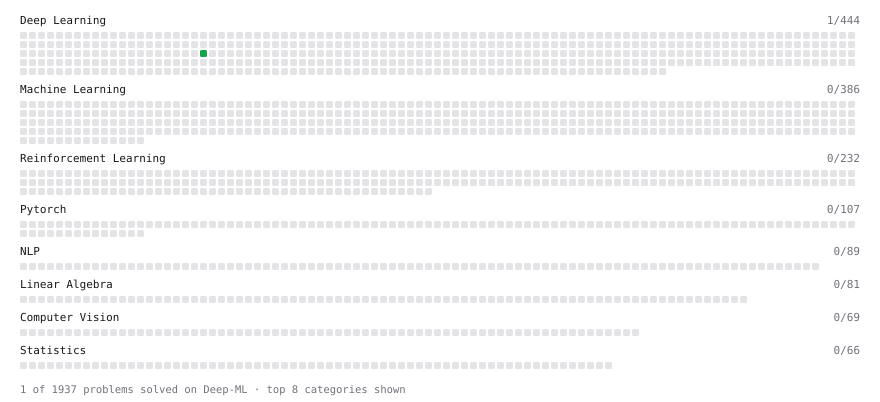

# Deep-ML

My machine learning practice from [Deep-ML](https://www.deep-ml.com). Every solution here was written by hand.

**6** solved · 6 problems · 0 labs · 0 math

[**Browse the interactive portfolio**](https://Ramdane-ait.github.io/deep-ml/) to replay this filling in over time.

## Problems

| | Difficulty | Solved | |
| --- | --- | --- | --- |
| [Dot Product Calculator](https://www.deep-ml.com/problems/83) | easy | 2026-11-07 | [solution](problems/0083-dot-product-calculator) |
| [Matrix-Vector Dot Product](https://www.deep-ml.com/problems/1) | easy | 2026-11-07 | [solution](problems/0001-matrix-vector-dot-product) |
| [Softmax Activation Function Implementation ](https://www.deep-ml.com/problems/23) | easy | 2026-11-07 | [solution](problems/0023-softmax-activation-function-implementation) |
| [Token Embedding Lookup Table](https://www.deep-ml.com/problems/945) | easy | 2026-11-07 | [solution](problems/0945-token-embedding-lookup-table) |
| [Build Scaled Dot-Product Attention](https://www.deep-ml.com/problems/490) | medium | 2026-11-08 | [solution](problems/0490-build-scaled-dot-product-attention) |
| [Implement Masked Self-Attention](https://www.deep-ml.com/problems/107) | medium | 2026-11-08 | [solution](problems/0107-implement-masked-self-attention) |

---

_This file is regenerated by Deep-ML on every push._
